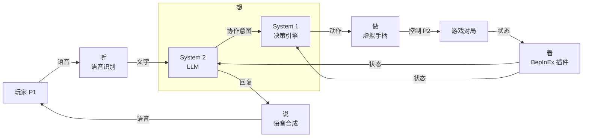

# CoChef

> 厨房可以胡闹，搭子必须靠谱 —— 一个实时陪你切菜、下锅、出餐，还能听懂你说话的 “胡闹厨房 2” (Overcooked! 2) AI 队友。

<!-- TODO: 顶部放一条 15–30s 高光 GIF，录好后替换为： -->

## 它是什么

想开一局胡闹厨房，却不想四处找人开黑？想指挥队友又怕语气太重，操作失误担心被吐槽？好不容易有空，朋友却不在线？

CoChef 是一个陪你玩《胡闹厨房 2》的 AI 队友：实时和你一起切菜、下锅、出餐，也能听懂你的分工和求助。你可以直接说「你洗盘子，我来炒菜」，也可以坦白说「这关我不太会，带带我」——不用斟酌措辞，也不用担心失误破坏气氛。随时可用、低压力、有情绪价值。

## 怎么做到的

CoChef 靠两层协作：

- **System 2（LLM）**：听懂你的发言、结合战局，生成带优先级和时机的协作意图，并负责开口回应你。
- **System 1（决策引擎）**：收益模型 + 行为树，综合协作意图与场上局势，权衡出当下最优动作并实时执行。

两层通过「听、看、想、说、做」串成一个闭环：



## 当前进展

截至 **2026-11**，主线已推进到 **4-6 关**（第 4 世界第 6 关）。进展持续更新，见 [进展记录](docs/progress.md)。

## 演示

[Level 1–6 完整演示视频（约 4 分半）](media/Level-1-6-demo.mp4)

<!-- 截图占位：主菜单 / 关卡内 -->

## 快速开始

### 1. 环境准备

- **代码**：`git clone https://github.com/tungyee/overcooked-ai`
- **游戏**：Steam 安装《Overcooked! 2》，游戏目录已装 BepInEx（插件宿主，首次安装见 [Windows](docs/setup-windows.md) / [macOS](docs/setup.md) 搭建文档）。
- **运行环境**：Python 3.9+。
- **模型**：语音协作需要 ASR/TTS/LLM 的 API Key，写入 `.env`（支持的服务见 [语音配置](docs/dialog_system.md)）。

### 2. 启动游戏

macOS：

```bash
./restart.sh            # 停旧 → 编译部署插件 → 起游戏 → 起 Agent
```

Windows：

```powershell
# 创建环境并部署插件
powershell.exe -NoProfile -ExecutionPolicy Bypass -File .\setup_windows.ps1 -GameDir 'D:\steam\steamapps\common\Overcooked! 2' -Deploy
# 前台启动并加入游戏
powershell.exe -NoProfile -ExecutionPolicy Bypass -File .\start_windows.ps1 -GameDir 'D:\steam\steamapps\common\Overcooked! 2' -NoVoice
```

游戏启动后，先在主菜单加入人类 P1，AI 会自动接管分屏 2P，进入任意双人关卡即可开黑。停止用 **Ctrl+C**。

### 3. 开始协作

- AI 自动接管分屏 2P，与人类玩家 P1 一起切菜、下锅、送餐、灭火。
- **语音协作**：装好依赖、在 `.env` 配好 key 后（见 [语音配置](docs/dialog_system.md)），按住说话键（PTT，默认 F8）说话，松开发送。例如：
  - 「你洗盘子，我来炒菜」
  - 「我不太会这一关的操作，带带我」
- AI 会结合你的发言与战局自主分工，遇到新订单还会主动开口跟你商量怎么配合。

## 常见问题

| 现象 | 处理 |
| --- | --- |
| 27411 能连、27412 超时 | 仍加载旧 DLL，重新编译部署插件并重启游戏。 |
| `not engaged`，AI 不动 | 回主菜单，只保留人类 P1，等虚拟手柄接入为 P2 再进关卡。 |
| 改了 Python 没生效 | 重启 Agent；改了 C# 要重新编译部署并重启游戏。 |

更多见 [排障](docs/troubleshooting.md)。

## 许可证

[MIT](LICENSE)。
