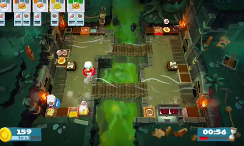
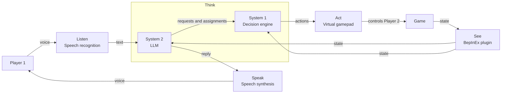
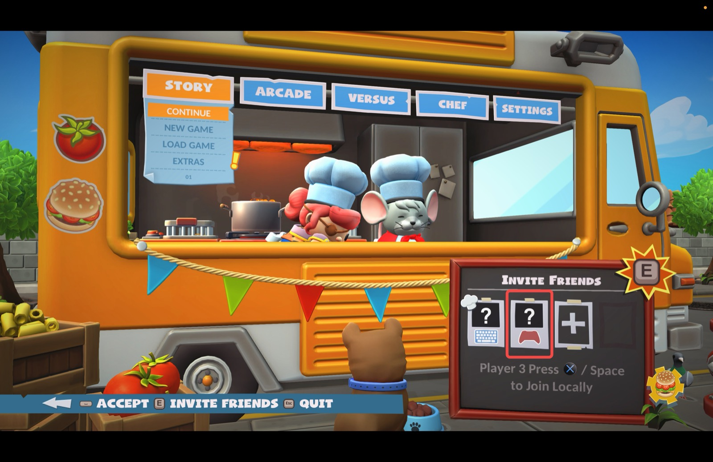
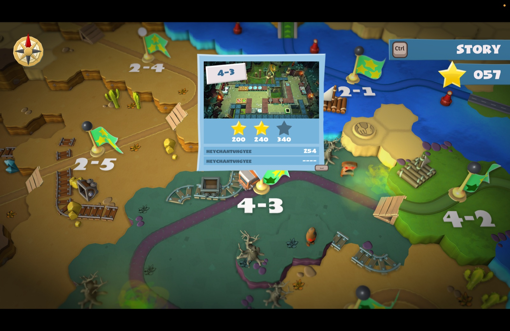

# CoChef — An AI Teammate for Overcooked! 2

[中文](README_CN.md)

> **Kitchen chaos? Your co-chef has your back.**
>
> An AI teammate for Overcooked! 2 that chops, cooks, and serves alongside you in real time and understands spoken requests.

<p align="center"></p>
<p align="center"><sub>CoChef plays as the red chef alongside the player in blue. <a href="media/Level-1-6-demo.mp4">Watch the full demo</a></sub></p>

## What is CoChef?

Friends offline? CoChef can join your local co-op game as Player 2. Ask it to take over the dishes while you cook, change jobs mid-round, or help out when things get hectic. CoChef currently replies in Mandarin Chinese.

## How it works

- **System 2 (LLM)** interprets your requests in the context of what’s happening in the kitchen, coordinates who does what, and replies out loud.
- **System 1 (decision engine)** uses a utility model to score available tasks and a behavior tree to carry out the chosen task through a virtual gamepad.



## Current progress

As of November 2026, we’ve reached **World 4, Level 6** in Story mode. [Progress log (Chinese)](docs/progress.md)

## Quick start

### 1. Set up

You’ll need the Steam version of *Overcooked! 2* and Python 3.9 or later. Clone the repository and open it in your terminal.

```sh
git clone https://github.com/tungyee/overcooked-ai-teammate
cd overcooked-ai-teammate
```

Complete the one-time setup for your platform. It covers the game plugin, Python environment, voice API credentials, and audio permissions. [macOS setup](docs/setup-en.md#first-time-setup) · [Windows setup](docs/setup-windows-en.md#first-time-setup)

### 2. Launch with voice

**macOS**

```bash
./restart.sh --voice
```

**Windows**

Run the command with the same game folder you used during setup.

```powershell
powershell.exe -NoProfile -ExecutionPolicy Bypass -File .\start_windows.ps1 -GameDir 'D:\steam\steamapps\common\Overcooked! 2' -Voice
```

### 3. Join and talk to CoChef

Join as Player 1 at the title screen. Wait for CoChef’s virtual controller to join as Player 2 in the main menu, then choose the level you want to play in local co-op.

Hold **F8** (the default push-to-talk key) while you speak, then release it. CoChef can suggest how to split the work at the start of a round and tell you where to move if the kitchen layout changes.

*Example translated from Mandarin*

> **Player** “Can you cook the rice first, then wash the dishes?”
>
> **CoChef** “Sure. I’ll get the rice going, then do the dishes.”

Press **Ctrl+C** in the terminal to stop CoChef.

<table>
  <tr>
    <td align="center" width="50%"><br><sub>The red controller shows CoChef has joined.</sub></td>
    <td align="center" width="50%"><br><sub>Choose a level in Story mode.</sub></td>
  </tr>
</table>

## FAQ

| Symptom | Fix |
| --- | --- |
| Port 27411 is reachable, but port 27412 times out | Rebuild and reinstall the plugin, then restart the game. If the problem persists, check `BepInEx/LogOutput.log` in the game folder. |
| CoChef doesn’t move and the log shows `not engaged` | Return to the main menu with one human player. Wait for CoChef’s virtual controller to join as Player 2 before entering a level. |
| Code changes haven’t taken effect | For Python changes, restart CoChef. For C# changes, rebuild and reinstall the plugin, then restart the game. |

## License

[MIT](LICENSE)
