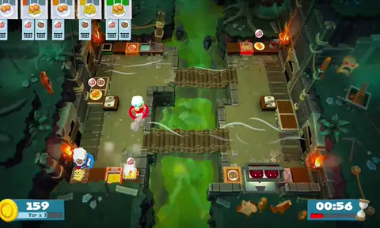
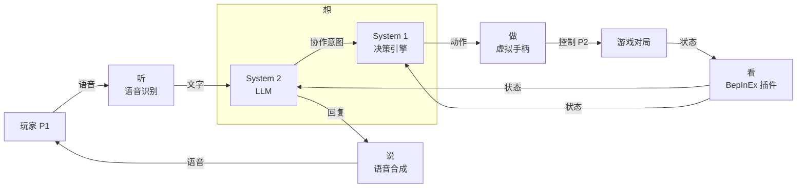
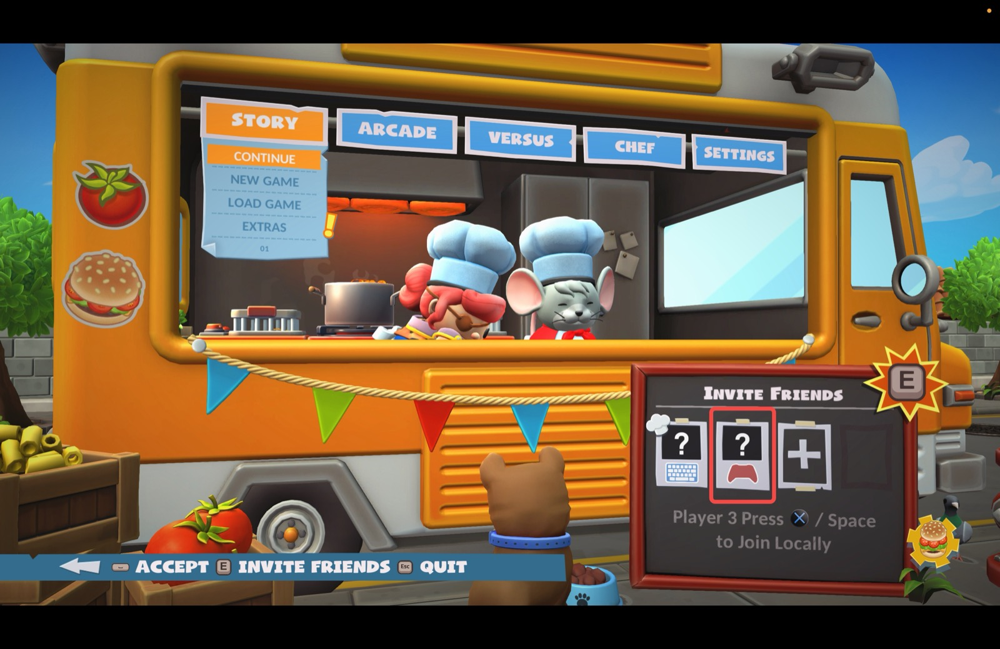
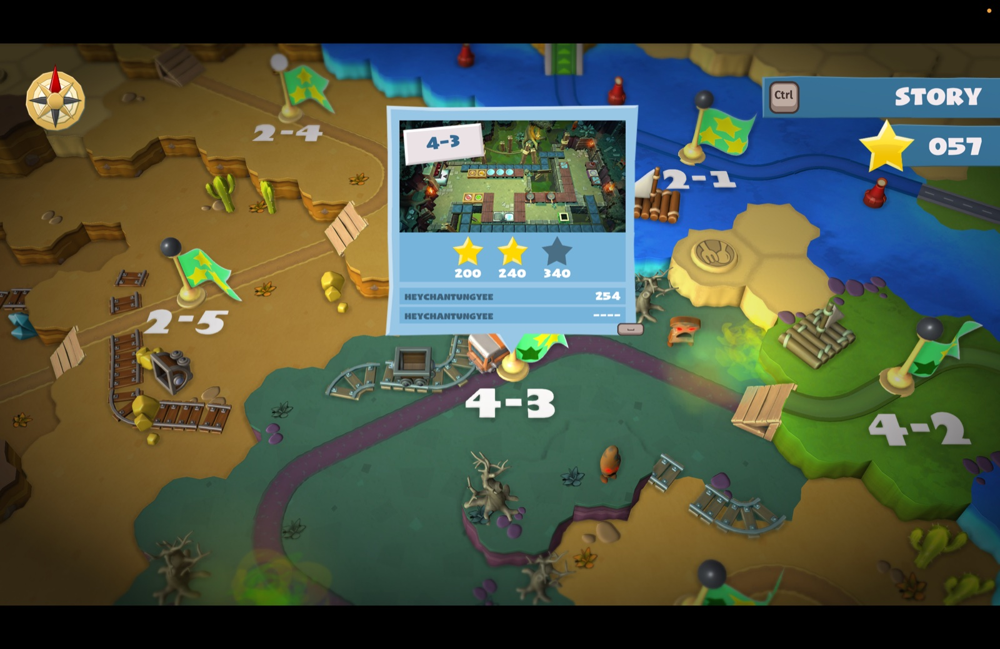

# CoChef — 胡闹厨房 2 AI 搭子

[English](README.md)

> 厨房可以胡闹，搭子必须靠谱！
>
> 一个实时陪你切菜、下锅、出餐，还能听懂你说话的 “胡闹厨房 2” (Overcooked! 2) AI 队友。

<p align="center"></p>
<p align="center"><sub>蓝色为人类玩家，红色为 AI。<a href="media/Level-1-6-demo.mp4">观看完整演示</a></sub></p>

## 它是什么

想开一局胡闹厨房，却不想四处找人开黑？想指挥队友又怕语气太重，操作失误担心被吐槽？好不容易有空，朋友却不在线？

CoChef 是一个陪你玩《胡闹厨房 2》的 AI 队友：实时和你一起切菜、下锅、出餐，也能听懂你的分工和求助。你可以直接说「你洗盘子，我来炒菜」，也可以坦白说「这关我不太会，带带我」——不用斟酌措辞，也不用担心失误破坏气氛。随时可用、低压力、有情绪价值。

## 怎么做到的

CoChef 靠两层协作：

- **System 2（LLM）**：听懂你的发言、结合战局，生成带优先级和时机的协作意图，并负责开口回应你。
- **System 1（决策引擎）**：收益模型 + 行为树，综合协作意图与场上局势，权衡出当下最优动作并实时执行。

两层通过「听、看、想、说、做」串成一个闭环：



## 当前进展

截至 **2026-11**，主线已推进到 **4-6 关**。进展持续更新，见 [进展记录](docs/progress.md)。

## 快速开始

### 1. 环境准备

安装 Steam 版《胡闹厨房 2》和 Python 3.9 或更高版本。克隆仓库后，在仓库根目录执行后续命令。

```sh
git clone https://github.com/tungyee/overcooked-ai-teammate
cd overcooked-ai-teammate
```

按平台完成首次配置，包括游戏插件、Python 环境、语音凭据和音频权限。 [macOS 搭建文档](docs/setup.md#首次配置) · [Windows 搭建文档](docs/setup-windows.md#首次配置)

### 2. 启动游戏和语音

**macOS**

```bash
./restart.sh --voice
```

**Windows**

把命令中的路径换成首次配置时使用的游戏目录。

```powershell
powershell.exe -NoProfile -ExecutionPolicy Bypass -File .\start_windows.ps1 -GameDir 'D:\steam\steamapps\common\Overcooked! 2' -Voice
```

### 3. 加入游戏并开口协作

在标题画面加入人类 P1。进入主菜单后，等虚拟手柄加入为 P2，再选择想玩的本地双人关卡。要停止 CoChef，在终端按 **Ctrl+C**。

按住说话键（默认 F8）说话，松开发送。CoChef 可以在开局提议分工，在厨房布局变化时提醒站位。

> **玩家** · 你先去煮饭吧，煮完饭之后洗碗。
>
> **CoChef** · 好，我先煮饭，煮完就去洗碗。

<table>
  <tr>
    <td align="center" width="50%"><br><sub>出现红色虚拟手柄，即表示 AI 玩家加入</sub></td>
    <td align="center" width="50%"><br><sub>在故事模式中选择关卡</sub></td>
  </tr>
</table>

## 常见问题

| 现象 | 处理 |
| --- | --- |
| 27411 能连、27412 超时 | 重新编译部署插件并重启游戏。若仍超时，查看游戏目录下的 `BepInEx/LogOutput.log`。 |
| `not engaged`，AI 不动 | 回主菜单，只保留人类 P1，等虚拟手柄接入为 P2 再进关卡。 |
| 改了 Python 没生效 | 重启 Agent；改了 C# 要重新编译部署并重启游戏。 |

## 许可证

[MIT](LICENSE)。
